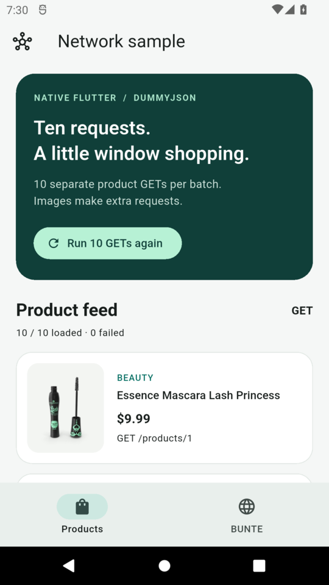
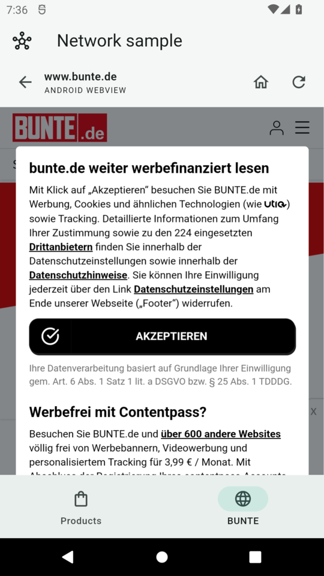
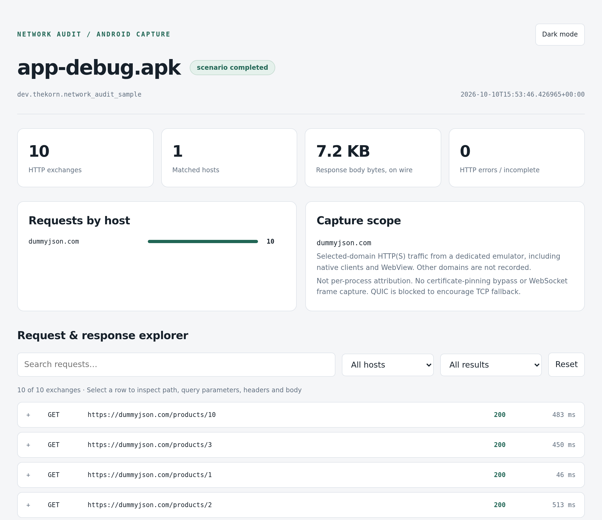
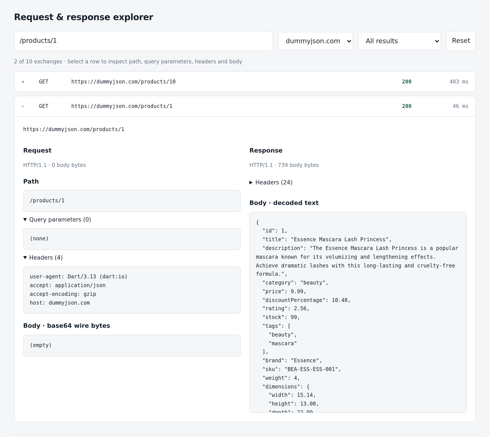

# What does your Android app actually send?

An app shows a product feed. Behind that screen are API calls, image downloads,
and perhaps a WebView loading an entirely different collection of services.
The screen tells you what the user sees. It does not tell you what crossed the
network to make it happen.

[network-audit](https://github.com/thekorn/network-audit) connects those two views.
Give it an Android APK or a Flutter project, use the app in a disposable emulator,
and finish with a searchable, offline report of the captured HTTP(S) requests and
responses. No logging SDK to add to the app. No manual proxy or certificate setup.

The easiest entry point is Nix:

```bash
nix run github:thekorn/network-audit -- /path/to/app.apk --domain api.example.com
```

Let's use the repository's sample app to go from a screen full of products to the
requests behind it, then look at how the same workflow fits exploratory debugging
and repeatable audits.

## A disposable device, not another debugging setup to maintain

Intercepting Android HTTPS usually involves several jobs before you can inspect
a single response: find an emulator image, configure a proxy, install a trusted
certificate, build and install the app, and collect the results. It is easy to
spend more time preparing the environment than investigating the app.

network-audit puts that setup inside a single run. It starts mitmproxy, boots a
fresh Android API 36 emulator, installs a session-only certificate authority into
Android's system trust stores, and launches the app. Traffic goes through the
emulator's network-level proxy, including native Dart HTTP clients that ignore
Android's system proxy setting.

Selected requests and responses print in the terminal as they happen. When the
run ends normally, on Ctrl+C, or after a handled failure, the tool saves the
report and tears down its emulator and proxy. Existing AVDs and the host's trust
store are left alone. The disposable device is gone; the capture remains.

This is HTTP(S) inspection, not a universal packet sniffer or a certificate-pinning
bypass. That boundary matters, and we'll come back to it.

## Let Nix bring the tools

The default Nix package supplies the CLI and its pinned dependencies: mitmproxy,
Python, Flutter, Java, the Android SDK and emulator image, and the runtime for
automated scenarios. You do not need Android Studio, a separate devenv install,
or a manual npm install. The `--` separates Nix's arguments from network-audit's
arguments.

You do need a supported host:

- **Apple Silicon macOS**, running Nix natively rather than through Rosetta; or
- **x86_64 Linux** with readable and writable `/dev/kvm`. Use a graphical session
  with a working X11/XWayland display for the interactive emulator window.

Intel Macs and ARM Linux are not supported. A container without hardware
acceleration is not a substitute for a supported emulator host.

Enable `nix-command` and `flakes` in your Nix configuration if they are not already
enabled:

```ini
experimental-features = nix-command flakes
```

Expect a **multi-gigabyte first toolchain download**, with builds where needed;
Nix reuses those results on later runs. Flutter and Gradle also download the
application's dependencies on the first build. Leave at least 8 GiB free on the
temporary filesystem for the disposable device, plus space for the Nix store,
builds, and caches. `TMPDIR` can select an existing writable directory on a larger
filesystem; `--output` moves reports, not the emulator's temporary disk.

The package accepts the [Android SDK license](https://developer.android.com/studio/terms)
declaratively. Using it assumes you accept those terms.

## Try it on an app with two different kinds of traffic

The [sample app](../sample-app/README.md) needs no account, API key, or local
backend. Its **Products** tab uses native Dart HTTP requests to fetch ten products
from DummyJSON. Its **BUNTE** tab opens the live BUNTE website in an Android
WebView. That makes it useful for seeing both app-owned API calls and embedded
web traffic in one session.

Clone the repository for the demo app, then let Nix supply the tool:

```bash
git clone https://github.com/thekorn/network-audit.git
cd network-audit

nix run github:thekorn/network-audit -- sample-app \
  --domain dummyjson.com \
  --domain '*.bunte.de' \
  --record
```

The clone is only needed here because we want the sample source. For an APK you
already have, the first command in this article works without a checkout.

network-audit restores the Flutter project's locked dependencies, builds a debug
APK, and opens it in a fresh emulator. Leave the terminal running while you use
the app.

The illustrations below use earlier native Android captures, not one continuous
recorded journey. The report examples use a separate, single-batch session.

### First, follow the ten product requests

On launch, the sample sends ten separate, concurrent GET requests to
`https://dummyjson.com/products/1` through `/10`. Once they succeed, the app shows
**10 / 10 loaded · 0 failed**.



*A native Flutter feed, backed by ten independent API calls. Product thumbnails
make additional requests; “ten products” does not mean “ten network requests in
total.”*

Scroll through the feed, return to the top, and tap **Run 10 GETs again**. That
sends another batch of ten API requests. The app does not cache those product
calls or retry them automatically, so two successful batches give you a useful
check: each product endpoint should appear twice in the capture.

Image caching is a different story. The exact hostname `dummyjson.com` does not
include its subdomains or unrelated image hosts. The command above focuses on
the API and BUNTE; it is not an inventory of every connection the app makes.

### Then, open the WebView

Tap **BUNTE**, deal with the website's consent prompt as appropriate, and scroll
the page. The WebView is created only on the first visit to that tab, so the
initial product load does not also start loading the website.



*An earlier native capture of BUNTE's consent prompt, before accepting it. The
website is rendered inside the app, but the prompt still obscures its content.*

The wildcard is quoted so your shell does not expand it. `*.bunte.de` includes
`www.bunte.de` and deeper subdomains, but **not** the apex `bunte.de`. Add
`--domain bunte.de` if you need that host too. Third-party domains outside the
filter pass through without being intercepted or recorded; filtering is not
network blocking.

### Finish the capture, not the emulator process

Press **Ctrl+C once** in the terminal and wait for the report path. Alternatively,
press Android's Home button and leave the app in the background for five seconds.
Avoid killing the emulator process, especially when recording: the tool needs
time to finalize and retrieve the video.

Adding `--record` saves a silent `recording.mp4` beside the report. It captures
the Android display, not the host's desktop or audio, and works in headless mode
too. A video gives the requests context: which screen was open, what was tapped,
and what happened next.

## Read the report as a conversation between app and server

Open the printed `report.html` path in your browser. It is a self-contained file:
no report server, external assets, or network connection is needed to inspect it.



*A separate saved capture of the sample APK: one product batch, ten HTTP 200
responses, and only `dummyjson.com` selected. This is not the two-batch,
multi-domain walkthrough above.*

In your multi-domain capture, select `dummyjson.com` in the host filter to check
the product batches without digging through the WebView's requests. Search for
`/products/1`, expand an exchange, and inspect the path, query parameters, headers,
JSON body, status, and duration. Search is text-based, so `/products/1` can also
match `/products/10`; check the expanded path when counting a particular endpoint.



*The UI shows a product; the report shows the HTTP exchange that supplied it.*

[Watch the nine-second report walkthrough (MP4)](images/network-audit/report-demo.mp4):
filter the saved capture, inspect a product response, check for errors, and reset.
This is a browser recording of the offline report, not an Android `--record`
video.

Use **Errors / incomplete** to find HTTP failures, transport errors, and requests
that had not finished when capture stopped. A failed request is different from a
TLS handshake failure: TLS diagnostics may explain why no HTTP response exists.

Each session lives under `.network-audit/runs/<session>/` by default. Alongside the
HTML, `report.txt` gives request counts per hostname, `events.jsonl` retains
structured capture records, and `flows.mitm` keeps the selected raw flows for
further mitmproxy analysis. Body previews are limited by default; the complete
captured bodies remain in the raw flows. Add `--output /path/to/audits` to choose
another parent directory.

**Treat captures as private data.** Cookies, tokens, URLs, headers, bodies, and
screen recordings are not automatically redacted. Review them before sharing;
do not commit raw sessions. A disposable emulator does not make its output safe
to publish.

## Use it for exploration, then make the journey repeatable

The manual workflow is a good starting point when you are still asking questions:
Does opening this screen fetch data again? Does a refresh issue duplicate calls?
Which selected hosts appear after interacting with a WebView? A short capture
lets you investigate one user journey without keeping a debugging emulator around.

When you know the journey, the experimental **Mobilewright scenarios** let you
repeat it. The repository includes one:

```bash
nix run github:thekorn/network-audit -- sample-app \
  --scenario sample-app/scenarios/browse.toml \
  --headless \
  --record
```

Its [TOML entry point](../sample-app/scenarios/browse.toml) selects capture domains,
a JavaScript executor, and emulator dimensions:

```toml
domains = ["*.bunte.de", "dummyjson.com", "*.doubleclick.net"]
executor = "browse.mjs"
dimensions = { width = 1280, height = 2856, density = 480 }
```

Dimensions configure Android only. On iOS, scenario `dimensions` and CLI
`--dimensions` are ignored with a warning, so shared scenarios can keep their
Android settings. Values must still pass normal CLI/schema validation; choose
the iOS Simulator display with `--ios-device-type` instead.

The [executor](../sample-app/scenarios/browse.mjs) waits for the first product
batch, scrolls the feed, runs a second batch, opens BUNTE, accepts consent,
declines the optional push-notification prompt if it appears, scrolls the WebView,
and waits five more seconds. Completion ends the capture automatically.

Unlike the manual example, this scenario also captures DoubleClick subdomains.
It accepts the site's advertising/tracking consent in the disposable emulator.
Read the executor before running it: scenarios are trusted local JavaScript with
access to the host environment, not sandboxed test data.

Automation here is still experimental, and a live website is not a stable test
fixture. A changed consent dialog, unavailable endpoint, or automation-driver
limitation can fail the scenario. Failures after session creation still produce
a partial report and a `scenario.log`. Successful UI steps also do not imply that
every HTTP response succeeded. See the [scenario documentation](../network-audit/README.md#experimental-mobilewright-scenarios)
for platform-specific limitations.

If the question is “which hosts am I missing?”, create a separate scenario TOML
beside the bundled executor, for example `sample-app/scenarios/discover.toml`:

```toml
executor = "browse.mjs"
```

Run it with `--scenario sample-app/scenarios/discover.toml`. Omitting `domains`
captures all HTTP(S) reaching the proxy across the **whole dedicated emulator**,
including traffic not attributable to the sample app. This is broader discovery,
not proof of per-app ownership. An empty `domains = []` is invalid, and a manual
run without a scenario still needs `--domain`. Explicit `--domain` flags replace,
rather than extend, a scenario's filter.

## Bring your own APK, Flutter project, or saved session

An existing APK is the shortest path when you do not need a build:

```bash
nix run github:thekorn/network-audit -- ./my-app.apk --domain api.example.com
```

It needs a launcher activity and must support the emulator's ABI: ARM64 on Apple
Silicon, x86_64 on Linux, or no native code. network-audit reads the package and
activity names from the APK.

For a Flutter source project, pass its directory and keep `pubspec.lock`
committed. For your own project with a configured staging flavor, for example:

```bash
nix run github:thekorn/network-audit -- /path/to/flutter-project \
  --domain api.example.com \
  --flavor staging \
  --dart-define-from-file /path/to/config/staging.json
```

These build options do not apply to prebuilt APKs. `--use-fvm` is available when
you want the project's FVM-managed Flutter SDK instead of the bundled Flutter;
FVM must already be installed. The [usage guide](../network-audit/README.md)
has the configuration details.

You can also regenerate a saved session's HTML and text reports without an
emulator. Use the smaller core package so you do not need the Android toolchain
on the machine doing that work:

```bash
nix run github:thekorn/network-audit#network-audit-core -- \
  report .network-audit/runs/YOUR_SESSION
```

For repeatable tooling, replace the moving GitHub reference with
`github:thekorn/network-audit/<commit>`. Pinning the tool does not freeze the app's
backend responses or a third-party website. If you use network-audit regularly,
`nix profile add github:thekorn/network-audit` installs the command into your Nix
profile; the `nix run` form is enough to try it.

## What an audit can—and cannot—tell you

network-audit is useful for bounded debugging sessions, reviewing API behavior,
exploring embedded web traffic, and recording repeatable user journeys. It is not
a load-testing tool or a complete privacy/compliance verdict.

Certificate pinning, custom trust stores, mutual TLS, and apps that reject
interception can prevent capture. DNS, arbitrary TCP/UDP, and WebSocket frames
are outside the report's scope. The emulator blocks UDP/443 to encourage QUIC
clients to fall back to HTTPS over TCP, but that does not make every protocol
capturable. This version manages its own rootable API 36 emulator; it does not
attach to a physical phone or an existing Google Play AVD.

Most importantly, **an empty report is not proof of no network activity**. Check
the domain filter, TLS diagnostics, and proxy/emulator logs before drawing that
conclusion.

Start small: launch the sample with `nix run`, refresh the product feed once, open
the WebView, and stop the capture. The useful result is not just a list of URLs.
It is a way to connect what you did in the app with what the network actually saw.
